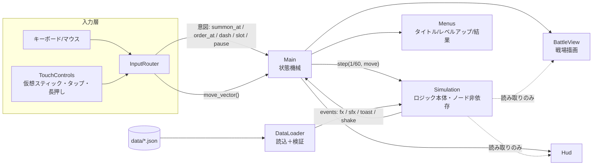
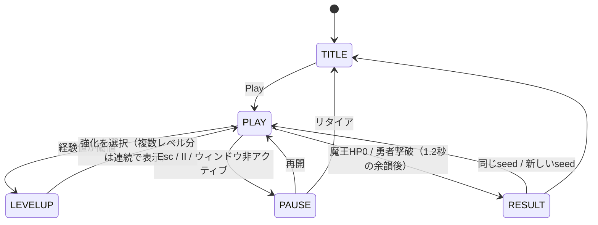

# アーキテクチャ（縦切りスライス v0.1）

## 全体像

## 責務

| 層 | ファイル | 役割 | 依存してよいもの |
|---|---|---|---|
| データ | `data/*.json`, `DataLoader` | バランス値の定義と検証 | なし |
| ロジック | `Simulation`, `Unit`, `SquadOrder`, `SpatialGrid`, `RngStreams` | 戦闘・召喚・命令・AI・ウェーブ・強化 | データ層のみ（ノード・描画・入力に依存しない） |
| 入力 | `InputRouter`, `TouchControls` | デバイス差を吸収して「意図」に変換 | なし（シグナルで通知） |
| 表示 | `BattleView`, `Hud`, `Menus`, `Sfx` | 描画・UI・音 | Simulation を読むだけ |
| 配線 | `main.gd` | 状態遷移と各層の接続 | 全部 |
| 環境 | `Platform`, `Settings` | Web/デスクトップ/Steam の差、設定保存 | なし |

## 状態遷移

PLAY 以外ではシミュレーションを進めないので、ポーズ・レベルアップ中は時間・AI・攻撃がすべて止まる。

## 1ティックの処理順（`Simulation.step`）

1. 魔王移動（ダッシュ中はダッシュ方向）・各種クールダウン・魔力回復
2. ウェーブ出現（spawn 乱数ストリームのみ使用）
3. 空間グリッド再構築・ユニット数集計・シナジー判定
4. 味方AI → 敵AI（ターゲット再探索は0.2秒間隔で分散）
5. 移動適用 → 矢の判定（配下が射線を遮る）→ 押し合い・障害物・ワールド境界
6. 死亡処理（死霊再生判定・魂ドロップ・ボス撃破で勝利）→ 参照解放
7. 魂の吸引と経験値 → レベルアップ待ち数の加算

## 決定性（seed 再現）

- `_physics_process`（60Hz固定）で `step(1/60)` を呼ぶ。描画FPSに左右されない
- 乱数は用途別ストリーム（spawn / upgrade / misc / map）。演出が増えても出現と強化候補の順序は変わらない
- 同じ seed ＋ 同じ入力列なら状態が完全一致することを `test_full_determinism` で確認
- 敵の出現位置は魔王の位置基準なので、人の操作では完全一致しない（仕様の受け入れ条件「敵発生・強化候補の順序」は満たす）

## タッチ対応の考え方

- タッチは `TouchControls` が受け取り、マウスと同じ `InputRouter` のシグナルに変換する。ゲーム側はデバイスを区別しない
- タッチから自動生成されるマウスイベント（`DEVICE_ID_EMULATION`）は無視して二重入力を防ぐ
- 実際に使われた入力で UI モードを自動切替（タッチ→ボタン表示、マウス/キー→非表示）
- タッチ時は `content_scale_factor` で論理解像度の短辺を約600にし、文字とボタンを指で扱える大きさにする

## 性能

- ユニットはノードではなく `RefCounted` の軽量オブジェクト。描画は `BattleView._draw()` で一括
- 近傍探索は一様グリッド（`SpatialGrid`）
- 計測: `test_perf_60_allies_80_enemies`（CIのログに ms/tick を出力）、ゲーム内 F3 のデバッグHUD（FPS・体数・AI時間）
- 1000体を目指す段階では、描画を MultiMesh に、AI を間引き更新に切り替える（ロジック層のインターフェースは維持）
